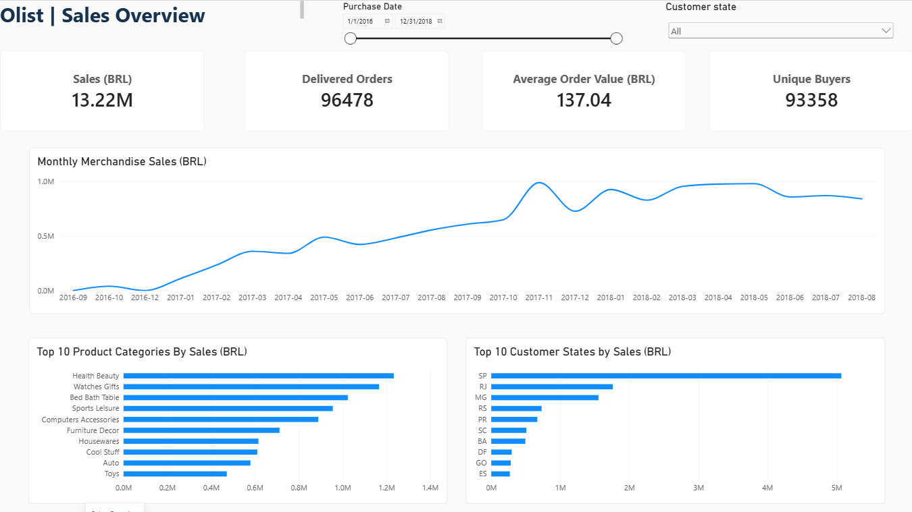
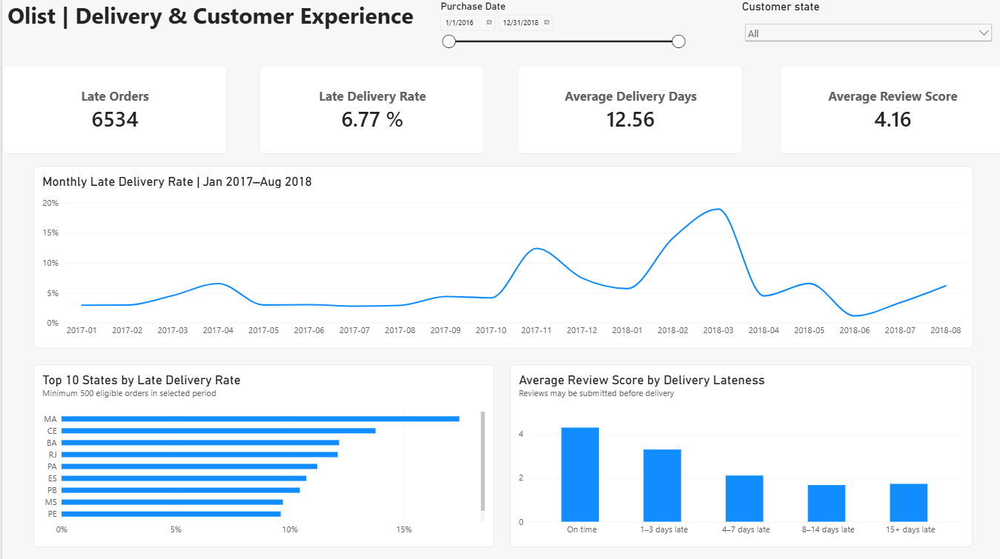

# Olist E-Commerce Analysis

I used Python, PostgreSQL, and Power BI to explore sales, delivery delays, and customer reviews in Olist's Brazilian e-commerce dataset. The aim was to understand where sales came from, which regions had delivery problems, and how review scores differed between on-time and late orders.

## Dashboard

### Sales Overview

### Delivery and Customer Experience

Both pages can be filtered by purchase date and customer state. The Power BI report file is included in the `dashboard/` folder.

## Tools Used

- **Python and pandas:** data inspection, cleaning, and validation
- **PostgreSQL:** joins, aggregations, analysis, and reporting views
- **Power BI and DAX:** data model, measures, and interactive charts
- **Git and GitHub:** version control and documentation

## Data Source

[Brazilian E-Commerce Public Dataset by Olist on Kaggle](https://www.kaggle.com/olistbr/brazilian-ecommerce/home/)

The dataset contains anonymized orders from 2016–2018. I inspected nine CSV files covering orders, customers, items, payments, reviews, products, sellers, category translations, and geolocation.

There are **99,441 orders**, including **96,478 delivered orders**. Raw data and generated datasets are excluded from this repository. The source data is licensed under **CC BY-NC-SA 4.0**; those terms apply to the data and outputs derived from it.

## What I Did

1. Checked missing values, duplicates, keys, and relationships between tables.
2. Cleaned dates and numeric fields, and flagged inconsistent order timelines.
3. Aggregated items, payments, and reviews to order level before joining them. This prevented orders with multiple records from inflating the totals.
4. Used SQL to analyze sales, delivery performance, reviews, repeat purchases, and payment differences.
5. Created separate order-level and item-level exports for Power BI, then validated them against the SQL results.
6. Built two report pages and checked their slicers and chart interactions.

Eight delivered orders had no customer-delivery date. I kept them in the dataset but excluded them from delivery analysis, leaving **96,470 eligible orders**. Valid zero payments and zero freight values were retained. Missing and untranslated product categories were kept identifiable. Geolocation was inspected but was not needed for the final report.

## Main Results

These figures use the full reporting period with no state selected.

| Metric | Result |
| --- | ---: |
| Delivered merchandise sales | BRL 13,221,498.11 |
| Delivered orders | 96,478 |
| Average order value | BRL 137.04 |
| Unique buyers | 93,358 |
| Late orders | 6,534 |
| Late delivery rate | 6.77% |
| Average delivery time | 12.56 days |
| Average review score | 4.16 / 5 |

- **São Paulo contributed the most sales:** 38.33% of delivered merchandise sales came from customers in SP. Health and beauty was the largest product category, with about BRL 1.23 million in sales.
- **Sales growth mostly came from more orders:** Comparing February–July in 2017 and 2018, sales increased by 134.42% and delivered orders by 130.80%. Average order value increased by only 1.57%.
- **Delivery problems varied by region:** Among states with at least 500 eligible orders, Maranhão had the highest late rate at 17.43% (125 of 717 orders). Rio de Janeiro had a lower rate of 12.11%, but a much larger total of 1,495 late orders.
- **Late orders had lower review scores:** Reviewed eligible orders averaged 4.29 when on time and 2.27 when late. This shows a relationship, but does not prove that delivery delays alone caused the difference.

## What a Business Could Investigate

- Look at both late delivery rates and late-order counts when deciding where to investigate first. A high-volume state can have more affected customers even with a lower rate.
- Break regional delays down by seller, route, and fulfillment stage to understand where problems occur.
- Track monthly delivery rates alongside order counts so small samples do not give a misleading picture.
- Check when customers submitted their reviews before using review scores to assess the delivery experience.

These are suggestions based on the analysis. I did not implement operational changes or measure their impact.

## Metric Definitions

- **Sales:** item prices for delivered orders, excluding freight. All amounts are in Brazilian reais (BRL).
- **Average order value:** delivered merchandise sales divided by delivered orders.
- **Unique buyers:** distinct `customer_unique_id` values for delivered orders.
- **Late delivery rate:** late eligible orders divided by all eligible orders.
- **Average delivery time:** average time from purchase to customer delivery for eligible orders.
- **Average review score:** average of each reviewed delivered order's mean score. Orders without scores are excluded, and each order has equal weight.

Date and state slicers filter both order and item data. Product categories filter item data; category-chart selections do not change the Sales Overview KPI cards.

## Things to Keep in Mind

- **2018 is incomplete.** I used the same February–July window for the growth comparison instead of comparing full-year totals.
- **Some reviews were submitted before delivery.** In a separate SQL check using only post-delivery reviews, averages were 4.29 for on-time orders and 3.72 for late orders. Far fewer late orders had post-delivery reviews, so that comparison also has limits.
- The monthly delivery chart starts in January 2017 and ends in August 2018. September 2016 had just one eligible order, which was late; its 100% rate would distort the chart. The KPI cards still use the full selected date range.
- The state ranking requires at least **500 eligible orders in the selected period**. A separate DAX measure applies that rule before ranking the Top 10. Short date ranges may show fewer states, and the chart is scrollable.
- Merchandise sales are not profit or Olist's commission revenue. The historical Brazilian dataset does not describe current operations or Canadian customers.

## Project Files

| Folder or file | Contents |
| --- | --- |
| `scripts/` | Python inspection, cleaning, and validation scripts |
| `sql/` | Numbered SQL scripts for setup, analysis, and exports |
| `reports/` | Saved data checks and analysis results |
| `dashboard/` | Power BI report and screenshots |
| `requirements.txt` | Python dependencies |

## Running the Analysis

1. Download the source CSVs from Kaggle into `data/raw/`.
2. Create a Python virtual environment and install the packages in `requirements.txt`.
3. Run the inspection and cleaning scripts in `scripts/`, following their input and output paths.
4. Create a PostgreSQL database and run the numbered SQL scripts in order. Change the local import/export paths and database settings to match your computer.
5. Run `scripts/validate_powerbi_exports.py` to check the reporting exports.
6. Load the five reporting exports into Power BI, or open the included report in Power BI Desktop. To refresh the report, replace the original account-specific source paths and credentials with your own.

The screenshots can be viewed directly without Power BI.
